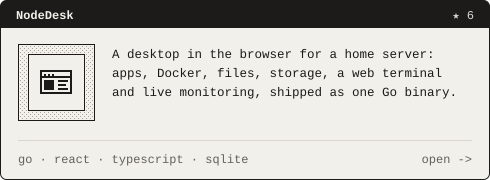
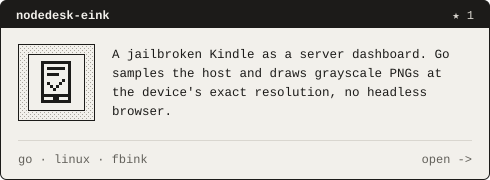
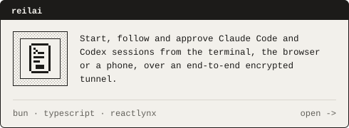
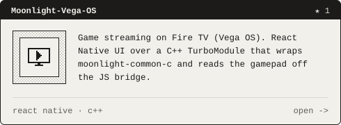
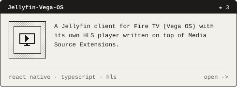
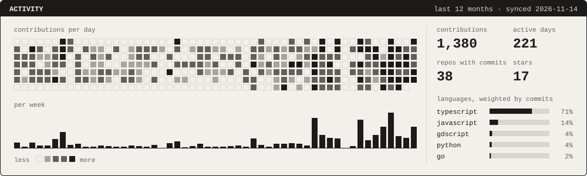
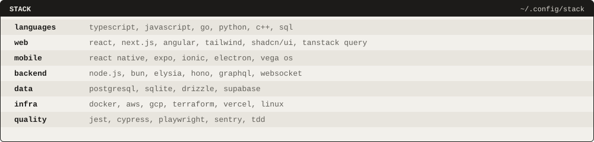
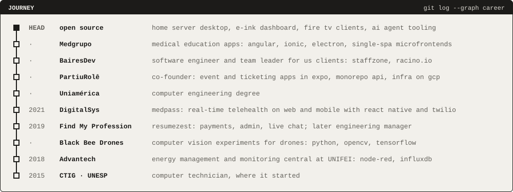

I'm Jonathan, a software engineer from Brazil. I build web and mobile products with React, React Native, Next.js, TypeScript, Go and Rust, mostly the parts with real-time data, payments or dense operational screens. AI coding agents are part of my daily workflow: I work with Claude Code and Codex, and build tooling for them, from MCP servers to a remote control for agent sessions.

On the side I build software for the screens around my house: a desktop for my home server, a Kindle that shows its health on e-ink, Fire TV clients and a way to drive AI coding agents from my phone. The cards below are the public ones.

### Projects

### Activity

### Stack

### Journey

Details

 

- **Medgrupo**: software engineer on medical education apps. An Angular + Ionic mobile app, its Electron desktop build and single-spa microfrontends deployed on S3 and CloudFront, including an offline-capable classroom check-in by QR code with facial biometrics.
- **BairesDev**: software engineer and team leader for US clients. On StaffZone, workforce dispatch for construction labor: drag-and-drop crew assignment, map-based scheduling, payroll and per-state tax flows (Next.js, Material UI, DnD Kit). On Racino.io, led the frontend of a gaming platform with Unity integration, avatars and USD and crypto payments (Expo, Next.js, GraphQL), and built its feature flag integration.
- **PartiuRolê**: co-founder and mobile lead of an event discovery and ticketing product. Built the buyer and producer apps in Expo on a shared UI library; the second version runs on a Bun + Turborepo monorepo with Next.js, Elysia and PostgreSQL, deployed to GCP with Terraform.
- **Uniamérica**: degree in Computer Engineering.
- **DigitalSys**: frontend engineer on Medpass, where nurses and doctors attend patients through chat and video on web and mobile (React Native, Expo, Twilio, Sentry).
- **Find My Profession**: software engineer, later managing the engineering roadmap. Built ResumeZest end to end: sign-up and payments, admin and customer areas, and a WebSocket chat between them (React, Redux-Saga, AWS, Nginx).
- **Black Bee Drones**: computer vision experiments for drones (Python, OpenCV, TensorFlow).
- **Advantech**: intern on the energy management and monitoring central at the Federal University of Itajubá, wiring industrial automation into software (Node-RED, InfluxDB).
- **CTIG · UNESP**: computer technician course.

### Contact

[LinkedIn](https://www.linkedin.com/in/jonathanfillipelemes) · [GitHub](https://github.com/JonathanLemes)

The images on this page are SVGs drawn by <a href="scripts/build.mjs">scripts/build.mjs</a>. A GitHub Action redraws them every day with fresh data.
